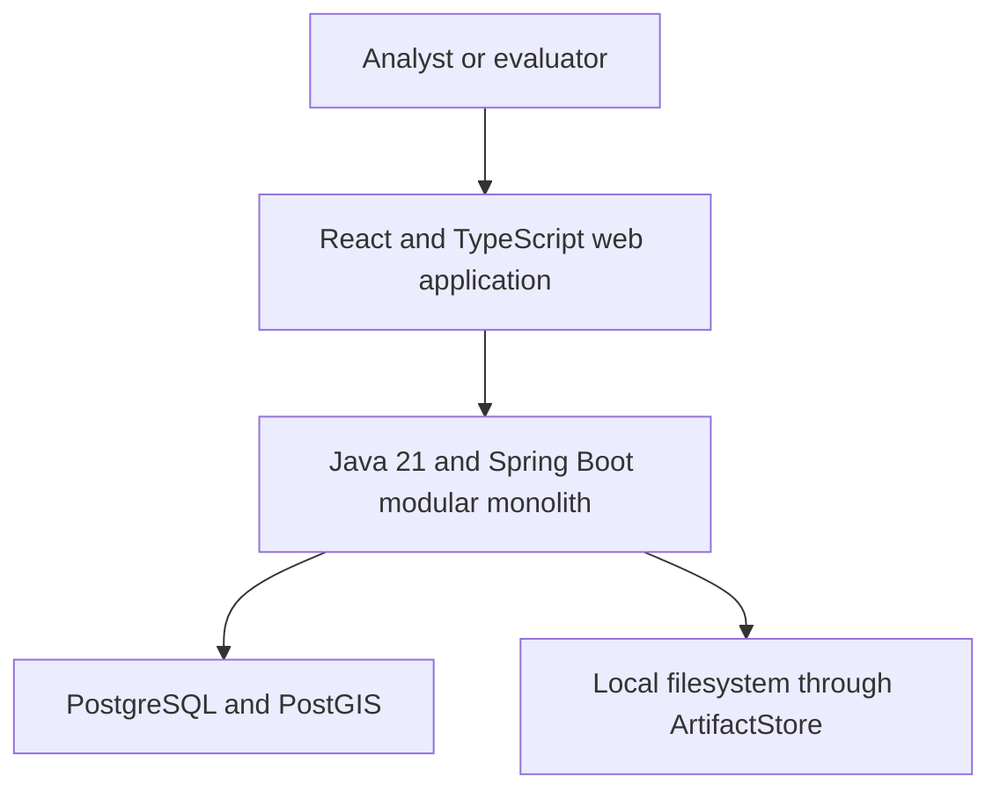
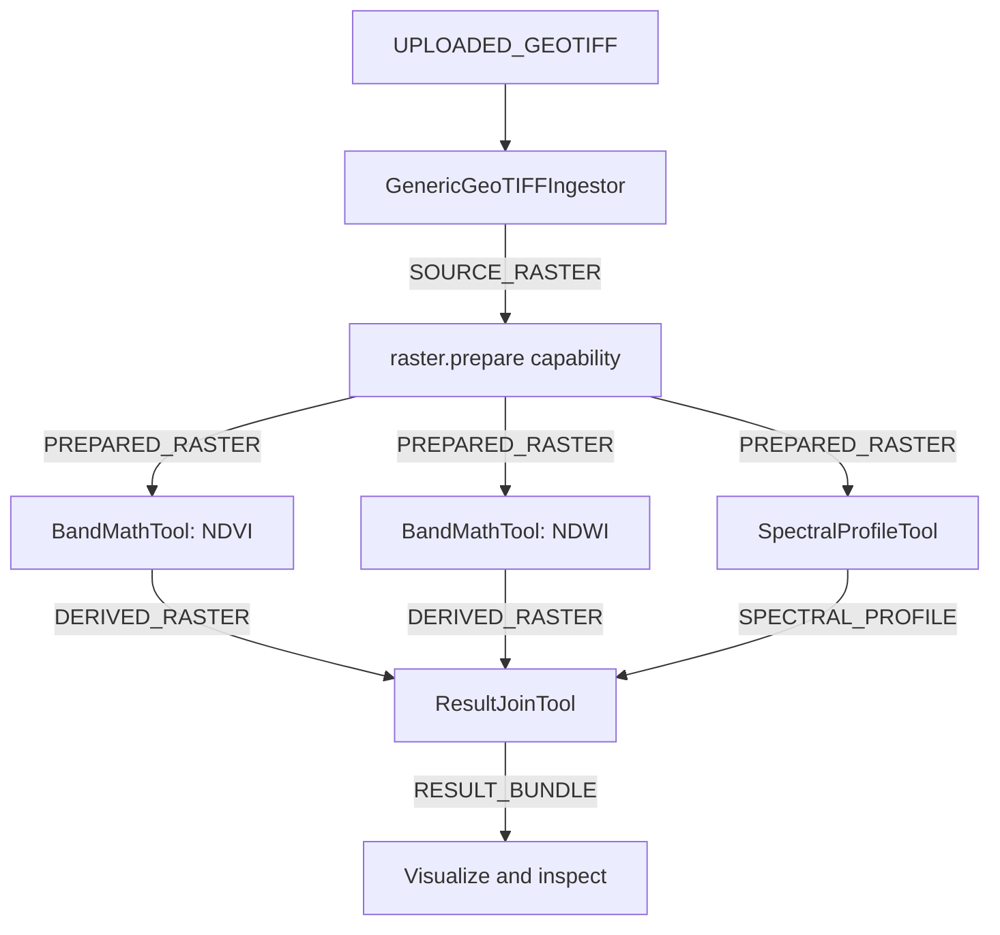

# Current Architecture — İYTE Graduation Project

| Field | Value |
|---|---|
| Status | Accepted intended architecture; implementation unverified |
| Version | 1.6 |
| Accepted | 2026-08-11 |
| Governing definition | `PROJECT_DEFINITION.md` |
| Governing scope | `IMPLEMENTATION_SCOPE.md` |

## 1. Purpose and authority

This document is the consolidated description of the currently approved intended architecture. It owns the system structure, component responsibilities, contracts, data and control flow, runtime topology, persistence boundaries, failure semantics, and verification architecture used to deliver the accepted BUILD scope.

It does not determine delivery classification or prove implementation status:

- `PROJECT_DEFINITION.md` governs the problem, contribution, stakeholders, boundaries, and success concept.
- `IMPLEMENTATION_SCOPE.md` governs BUILD, STRETCH, FUTURE, and OUT-OF-SCOPE classifications.
- accepted `decisions/ADR-*.md` files preserve the rationale for material choices.
- the repository and executable tests determine what is implemented and verified.
- `PROJECT_STATUS.md` is a planning aid whose material claims must be checked against repository evidence.

No component described here may be called implemented solely because it appears in this document. Accepted ADRs must be reflected here; disagreement between an ADR and this document is documentation drift.

## 2. Architectural objective

The system is a small plugin-based remote-sensing workflow platform designed to make the following properties visible, testable, and demonstrable:

- functional extensions behind explicit contracts;
- typed directed-acyclic-graph workflows and validation before execution;
- replacement of a processing implementation without changing the saved workflow, user interface, or generic platform core;
- reuse of one analysis implementation in pipeline and interactive contexts;
- observable end-to-end execution through a web application;
- separation of orchestration, domain implementation, persistence, and artifact storage.

The architecture optimizes for a complete graduation demonstration, not feature count, scientific completeness, distributed execution, or production scale.

## 3. Architectural drivers

In priority order:

1. Complete the accepted end-to-end demonstration reliably.
2. Keep platform boundaries and plugin contracts explicit and explainable.
3. Reject invalid workflow compositions before execution.
4. Prove processing-engine replaceability through the same logical workflow.
5. Permit extensions without plugin-specific branching in generic orchestration code.
6. Support deterministic automated verification and repeatable demonstration evidence.
7. Handle raster and result payloads by reference rather than embedding them in workflow state.
8. Remain feasible for one graduation-project timeline.

## 4. System context and BUILD runtime

BUILD uses a web client and a modular backend application with local infrastructure. It is not a microservice or distributed workflow system.



| Runtime element | Responsibility |
|---|---|
| React/TypeScript web application | Plugin catalogue, visual DAG editing, server-backed validation feedback, pipeline operations, job monitoring, result visualization, and pixel inspection |
| Java 21/Spring Boot modular monolith | REST API, application use cases, plugin runtime, workflow validation, engine resolution, in-process execution, catalogue services, and persistence coordination |
| PostgreSQL/PostGIS | Catalogue metadata and footprints, pipeline definitions and revisions, immutable execution snapshots, jobs, stage executions, and result-reference metadata |
| Local filesystem behind `ArtifactStore` | Uploaded GeoTIFFs, intermediate rasters, previews, and result payloads |
| Bounded in-process executor | Background job execution after an API submission returns |

BUILD does not contain Redis, MinIO, a Python service, a distributed queue, a separate processing service, an authentication subsystem, runtime JAR loading, or plugin hot reload.

## 5. Backend module responsibilities

The backend remains one deployable application, but its internal modules have explicit responsibilities.

| Module or boundary | Owned responsibility | Must not own |
|---|---|---|
| API adapters | HTTP request/response mapping and transport validation | Plugin-specific algorithms or orchestration branches |
| Application services | Use-case coordination for catalogue, pipelines, jobs, and interactive analysis | Direct filesystem or database details |
| Plugin kernel | Plugin contracts, descriptors, lifecycle concepts, registry, discovery, health, configuration, and capability lookup | Workflow persistence or UI logic |
| Workflow model and validator | Definitions, stages, ports, edges, parameter validation, type compatibility, and acyclicity | Concrete plugin implementation behavior |
| Execution engine | Snapshot binding, deterministic planning, stage invocation, state transitions, fan-out/fan-in coordination, and failure propagation | Scientific processing logic |
| Catalogue and artifact services | Raster metadata, footprints, artifact identity, reference resolution, preview metadata, and storage abstraction | Workflow scheduling |
| Persistence adapters | Mapping domain state to PostgreSQL/PostGIS and filesystem storage | Business rules that belong to contracts or application services |

Dependencies point from transport and infrastructure adapters toward application and domain contracts. Generic platform code depends on descriptors, capabilities, typed ports, and interfaces—not on concrete plugin classes.

## 6. Plugin model

### 6.1 BUILD categories

BUILD implements three plugin categories:

| Category | Responsibility | Mandatory implementations |
|---|---|---|
| `DataIngestor` | Inspect, catalogue, store, and reference an input dataset | `GenericGeoTIFFIngestor` |
| `ProcessingEngine` | Prepare raster data behind a replaceable processing boundary | `MockEngine`, `LightweightEngine` |
| `AnalysisTool` | Derive or inspect results through reusable analysis operations | `BandMathTool`, `SpectralProfileTool`, `ResultJoinTool` |

The shared plugin concepts include:

- a stable plugin identifier, version, category, and descriptor;
- declared input and output ports;
- declared capabilities;
- a parameter schema and configuration;
- lifecycle and health concepts;
- execution through a category-appropriate contract;
- access only to permitted platform services through a platform context or explicit dependencies.

`MLService` is not a BUILD category. It may be introduced only if the Python cloud-mask STRETCH item is explicitly undertaken after BUILD succeeds.

### 6.2 Registration and discovery

BUILD plugins are compiled, packaged, and deployed with the application. Each is a Spring-managed bean implementing one category contract, and Spring supplies the complete collection of plugin beans to `PluginRegistry` through dependency injection. Component annotations, configuration classes, and explicit `@Bean` methods are interchangeable implementation choices; the registry must neither construct implementations nor maintain a central list of them.

Every plugin exposes an immutable descriptor before execution. It contains at least:

- a globally unique stable identifier that is independent of Java class and Spring bean names;
- plugin version, category, human-readable name, and description;
- named input and output ports with recognized logical data types;
- declared capabilities;
- parameter schema.

BUILD permits one active version for each plugin identifier. Snapshot provenance records the version used but does not preserve or reload historical plugin binaries. A material change to public ports, parameters, capabilities, or observable processing behavior requires a version change; the version syntax is an implementation choice.

At startup, `PluginRegistry` collects the implementations, validates them, and creates immutable indexes by identifier, category, and capability. Discovery ordering is deterministic and independent of Spring bean-discovery order. Registry construction rejects at least:

- duplicate plugin identifiers;
- missing or malformed identifiers and versions;
- descriptor categories inconsistent with implemented contracts;
- missing, duplicate, invalid, undeclared, or internally inconsistent ports;
- ports using unrecognized logical data types;
- invalid parameter-schema declarations;
- malformed capabilities or capabilities inconsistent with the plugin category.

Multiple plugins may expose the same capability. The registry returns all matching candidates and never silently selects one from bean-discovery order. Capability-selection precedence is governed by ADR-005.

For a plugin that declares an authoritative capability such as `raster.prepare`, registry construction also verifies conformance with that capability's required category, port names, cardinalities, logical types, and workflow-visible parameter contract. A non-conforming provider is a structural startup error.

Any structurally invalid registered plugin causes startup to fail; it is not silently omitted or partially registered. After successful startup, registry structure remains immutable until restart. Runtime health changes do not add or remove entries.

Adding a BUILD-compatible implementation requires implementing its contract, declaring its descriptor, registering it through dependency injection, supplying plugin-compliance tests, and rebuilding and restarting the application. It must not require changes to the registry, validator, executor, controllers, or another generic central list.

The generic plugin kernel does not hard-code the mandatory BUILD implementations. Their presence is proven by an application-level integration or acceptance test. A saved workflow referring to an unavailable plugin is rejected during submission-time validation with an explicit missing-plugin error.

### 6.3 Lifecycle, health, and invocation

The common lifecycle is descriptor discovery, descriptor validation, initialization, ready execution, and shutdown. Simple plugins may use no-op initialization and shutdown. Initialization failure aborts startup, and already initialized plugins are shut down where practical.

Lightweight health or readiness is separate from the immutable descriptor and includes a reason when the plugin is unavailable. An unhealthy plugin remains registered but cannot be bound to a new execution. If it becomes unavailable after snapshot creation, invocation fails explicitly under the accepted fail-fast job semantics. BUILD does not include automatic repair, dynamic re-registration, or sophisticated health-monitoring infrastructure.

`PluginRegistry` holds one application-scoped instance for each identifier. Plugin implementations must therefore be stateless or thread-safe and must not retain mutable job, stage, input, result, or parameter state across invocations. Per-execution state is supplied through input `DataReference` values, validated effective configuration, an execution context, and local invocation state.

Plugins may use only platform services exposed through accepted contracts or dependency injection. They must not access persistence repositories directly, expose or persist raw filesystem paths, create hidden workflow schedulers, or depend on controller or frontend types.

The catalogue service, workflow validator, execution-snapshot binder, workflow executor, processing-engine resolver, and interactive-analysis service all discover implementations through `PluginRegistry`. They do not depend directly on concrete plugin classes. In particular, interactive spectral-profile inspection resolves the same registered `SpectralProfileTool` used by pipeline execution.

## 7. Typed data and artifact references

### 7.1 Centrally owned data types

BUILD uses the following minimal logical type set:

| Data type | Meaning |
|---|---|
| `UPLOADED_GEOTIFF` | A stored user upload or bundled fixture that has not yet been catalogued |
| `SOURCE_RASTER` | An ingested, catalogued raster |
| `PREPARED_RASTER` | Output from either BUILD processing engine |
| `DERIVED_RASTER` | An approved derived raster such as NDVI or NDWI |
| `SPECTRAL_PROFILE` | Spectral values with the associated coordinate and band metadata |
| `RESULT_BUNDLE` | An inspectable collection of child result references from multiple branches |

Compatibility is exact by default and is evaluated by a server-side `TypeCompatibilityService`. The web application may use server-provided descriptors and compatibility information for immediate feedback, but backend validation is authoritative.

No implicit conversion is part of BUILD. A future conversion must be an explicit stage or an explicitly accepted compatibility rule.

### 7.2 `DataReference`

Raster and result bytes do not travel inside pipeline definitions, execution snapshots, events, or job and stage records. Every published artifact receives a server-generated opaque `ArtifactId`. An `artifact://` serialization may represent that identity, but it must not reveal a filesystem path or storage layout.

Artifacts move through the system as immutable `DataReference` values containing at least:

- the artifact identifier;
- the centrally owned logical data type;
- media or representation information;
- byte size;
- checksum algorithm and digest;
- relevant immutable metadata, including geographic information where applicable.

PostgreSQL/PostGIS holds the authoritative artifact record. It may additionally record creation time, producing job and stage, output-port or result relationships, parent or preview relationships, and internal storage information. Existing execution and result relationships provide sufficient BUILD provenance; a separate complete provenance graph is not required.

Client-supplied type, size, checksum, and metadata claims are never authoritative. When a client submits an identifier, the backend loads the record and validates it against the required input. A full client-supplied reference that conflicts with the record is rejected explicitly.

A checksum verifies content; it is not the artifact identifier and does not imply content-addressed storage or deduplication. Opaque identity prevents storage-path leakage but does not provide authorization; authentication and access control remain FUTURE.

### 7.3 Artifact ownership and plugin access

Artifact handling has three explicit responsibilities:

| Boundary | Responsibility |
|---|---|
| `ArtifactService` | Identity, creation coordination, reference resolution, integrity verification, metadata, and application-level access rules |
| `ArtifactStore` | Physical staging, finalization, reading, existence checks, and storage-specific operations |
| Artifact metadata persistence | Authoritative records, types, checksums, metadata, timestamps, and execution or result relationships |

The BUILD `ArtifactStore` implementation stores payload bytes on the local filesystem. Application services, workflow code, and plugins do not access the filesystem adapter or artifact repository directly.

Plugins receive input references and restricted artifact access through their execution context or an explicit dependency. This access may provide a scoped readable or seekable input handle, a managed temporary output target, and publication of a completed output as a `DataReference`.

A backend-only local path may exist inside a scoped handle when a raster library requires it. The path must not be returned as a plugin result, persisted in domain state, used as artifact identity in logs, exposed through an API, or selected or constructed by a plugin. Plugins do not choose final filenames or storage locations. Original upload names may be retained only as display metadata and never determine storage paths.

### 7.4 Immutability and staged publication

A published artifact is immutable. Its bytes, logical type, checksum, semantic metadata, and identifier cannot be overwritten, retyped, or reused for another payload. Every successful transformation publishes a new artifact identity:

- an `UPLOADED_GEOTIFF` remains the original upload;
- `GenericGeoTIFFIngestor` publishes a distinct `SOURCE_RASTER` even if it copies the bytes unchanged while adding catalogued metadata;
- a processing engine publishes a new `PREPARED_RASTER`;
- each band-math branch publishes its own `DERIVED_RASTER`;
- `SpectralProfileTool` and `ResultJoinTool` publish new `SPECTRAL_PROFILE` and `RESULT_BUNDLE` artifacts.

Artifact creation uses staged publication:

1. `ArtifactService` allocates an opaque identity and managed staging target.
2. The producer writes and closes the complete payload.
3. Size, checksum, representation information, and applicable metadata are established.
4. `ArtifactStore` finalizes the payload without exposing a partial file.
5. The authoritative metadata record is persisted.
6. Only then is a usable `DataReference` returned.

No workflow, API response, job result, or downstream stage may observe a reference to a partially written artifact. After a plugin returns all declared outputs, the executor validates their names and logical types. The complete output-reference map and the stage transition to `SUCCEEDED` are recorded in one database transaction; dependent stages become eligible only after it commits.

The filesystem and database do not share a distributed transaction. A failure between payload finalization and metadata or stage-result persistence may therefore leave unreferenced bytes or metadata. In that case the stage is not successful, no downstream stage receives an incomplete output set, and best-effort removal may be attempted. Cleanup failure never creates a valid result, and BUILD does not require automated orphan reconciliation.

### 7.5 Resolution and integrity

`ArtifactService` is the only authority for resolving a reference. Before consumption it verifies that:

- the authoritative record exists and has the required logical type;
- backing bytes exist;
- recorded size and checksum information are present;
- the bytes match the recorded size and checksum.

A successful integrity check for the same immutable artifact may be memoized within one execution. The checksum algorithm and optimization strategy remain implementation choices.

Missing metadata or bytes, a type mismatch, or a size or checksum mismatch in an external pipeline input rejects submission before a runnable snapshot or job is created. The same condition discovered for an intermediate or result artifact during execution is an explicit artifact-access or integrity failure; the current stage and job follow fail-fast semantics.

An unknown, unpublished, missing, or incorrectly typed plugin output reference is a plugin-contract runtime failure. Artifact failures are not represented as generic nulls, missing ports, or successful empty results.

### 7.6 Fan-out, small results, and previews

Fan-out passes the same immutable `DataReference` to every dependent branch without copying its bytes. The NDVI, NDWI, and spectral-profile branches may therefore safely share one `PREPARED_RASTER`.

`SPECTRAL_PROFILE` is a stored JSON result artifact. `RESULT_BUNDLE` is a stored manifest artifact containing named child references for the two `DERIVED_RASTER` results and the `SPECTRAL_PROFILE`. `ResultJoinTool` verifies the presence and logical type of every child but does not copy child payloads, merge raster pixels, claim scientific fusion, or replace child identities.

An API may resolve and return parsed small JSON content for display, while persisted execution state retains references. A web-renderable preview is a separate auxiliary artifact associated with its canonical raster result; it is not another workflow logical type and cannot replace the scientific raster. Preview content and geographic bounds are served through the artifact boundary without exposing a storage path.

Raw filesystem paths must not appear in saved workflows, snapshots, job or stage records, plugin outputs, or public API representations.

## 8. Pipeline model and server-owned validation

### 8.1 Authority and type ownership

The backend is the sole authority for workflow validity. `WorkflowValidator` applies graph and parameter rules using `TypeCompatibilityService` and the immutable plugin descriptors and capability contracts exposed through `PluginRegistry`.

Workflow definitions identify stages, references, and named ports; they are not trusted to declare their own port types. The backend derives a port's type from:

- the registered plugin descriptor when a stage references a plugin identifier;
- an authoritative capability contract when a stage references a capability.

A capability contract has one stable typed port shape independent of the implementation later selected. In particular, `raster.prepare` accepts `SOURCE_RASTER` and returns `PREPARED_RASTER` for both BUILD engines. Definition validation therefore does not arbitrarily select `MockEngine` or `LightweightEngine`. Provider conformance and selection precedence are governed by ADR-005.

Type compatibility remains exact by default. BUILD has no implicit conversion, subtype hierarchy, automatic raster coercion, edge transformation, or metadata-dependent type rule.

The frontend obtains descriptors and type information from the backend and may prevent obvious errors, highlight issues, and invoke server validation while editing. This feedback is advisory: it cannot authorize persistence or execution. API adapters may reject malformed transport data, but architectural workflow validation belongs to `WorkflowValidator`.

### 8.2 Definition, port, and binding model

The conceptual workflow model contains:

- `PipelineDefinition`: reusable workflow identity, metadata, revision, parameters, stages, edges, external inputs, and declared results;
- `PipelineStage`: a unique stable stage identity, a plugin or capability reference, and stage configuration;
- `PipelineEdge`: a connection from one existing named output port to one existing named input port;
- `PipelineInput`: a named external input bound to one stage input port;
- `PipelineResult`: a named workflow result bound to one stage output port;
- `ExecutionSnapshot`: an immutable submitted graph with input bindings, resolved plugin identities and versions, engine binding, effective configuration, and typed result bindings;
- `Job` and `StageExecution`: runtime state separate from the reusable definition;
- `DataReference`: input, intermediate, and result references.

BUILD input ports are single-valued:

- a required port has exactly one binding;
- an optional port has zero or one binding;
- a binding comes from either one upstream edge or one declared pipeline input, never both.

One output port may feed multiple downstream input ports; this is fan-out. Fan-in is a stage with several distinct named inputs, not several edges entering one port. `ResultJoinTool` therefore has three required inputs—two `DERIVED_RASTER` ports and one `SPECTRAL_PROFILE` port—and performs no implicit merging or aggregation.

The accepted demonstration binds its uploaded GeoTIFF pipeline input to the ingestor's `UPLOADED_GEOTIFF` port and declares the join tool's `RESULT_BUNDLE` output as the terminal pipeline result.

BUILD has no conditional or fallback edges, loops, edge expressions, edge transformations, or variadic input ports.

### 8.3 Validation operations and persistence

The backend exposes an explicit validation operation for a transient definition. It returns a structured report and creates no revision, snapshot, job, or artifact. Saving a pipeline invokes the same semantic rules, and only a valid definition or revision is persisted. Persistent incomplete drafts are not part of BUILD; an unfinished graph remains in frontend editor state.

Definition validation does not require a concrete uploaded artifact or a selected processing-engine implementation. It does require explicit pipeline input and result declarations, registered plugin contracts, and resolvable capability contracts.

Before a definition can be saved, validation rejects at least:

1. an empty workflow;
2. malformed or duplicate stage, edge, pipeline-input, or pipeline-result identities;
3. references to missing stages or nonexistent or incorrectly directed ports;
4. duplicate edges or more than one binding to a single-valued input;
5. required inputs lacking an upstream edge or declared pipeline-input binding;
6. incompatible edge, pipeline-input, or pipeline-result types;
7. missing plugin identifiers, invalid capability contracts, or category-reference mismatches;
8. missing, unknown, incorrectly typed, or constraint-violating parameters;
9. cycles, including self-cycles;
10. stages unreachable from a pipeline input or unable to contribute to a declared result;
11. unsupported conditional, fallback, loop, variadic, or edge-transformation semantics.

Conditions that depend on actual artifact contents, such as whether a raster contains a required band, remain explicit plugin runtime preconditions rather than graph-validation rules.

The validation report contains a valid/invalid result, stable issue codes, human-readable explanations, and locations for the relevant stage, edge, port, parameter, or pipeline binding. Issues are returned in deterministic order. The validator collects independent errors where practical while suppressing misleading cascades. BUILD does not require a warning or severity framework; every reported validation issue blocks persistence or submission.

Submitting a saved pipeline revalidates the exact submitted revision. Prior validation or persistence does not bypass this check. Submission-time validation additionally verifies:

- all required external inputs are bound and no undeclared inputs were supplied;
- supplied artifact identifiers resolve through authoritative records, have the required logical types, and pass existence, size, and checksum verification;
- referenced plugins and capabilities remain available;
- required implementations are healthy enough to bind;
- processing-engine resolution succeeds under ADR-005;
- effective parameter values and defaults remain valid.

A definition that was valid when saved may therefore become non-executable after plugin removal or an incompatible upgrade, and submission reports that condition explicitly.

### 8.4 Snapshot and runtime boundary

An invalid submission creates no runnable execution snapshot or queued job. After successful validation and binding, the immutable snapshot records the exact validated graph, external input bindings, resolved plugin identifiers and versions, effective configuration, processing-engine binding, and typed pipeline-result bindings. Later definition edits cannot affect an active or historical job.

The executor operates only on this snapshot. It does not repair graphs, infer connections, choose ports by position, perform implicit conversion, or reinterpret client-provided type claims.

At runtime, the executor defensively verifies actual plugin inputs and outputs against their declared `DataReference` types. A missing, undeclared, or incorrectly typed plugin output is an explicit plugin-contract runtime failure governed by fail-fast execution semantics; it does not retroactively make the saved definition structurally invalid.

## 9. Processing-engine resolution

### 9.1 Stable capability contract

The plugin kernel owns one active immutable workflow-facing contract for `raster.prepare`:

| Property | Required value |
|---|---|
| Category | `ProcessingEngine` |
| Input | `sourceRaster: SOURCE_RASTER`, exactly one |
| Output | `preparedRaster: PREPARED_RASTER`, exactly one |

The contract, rather than a selected engine descriptor, supplies the ports used during definition validation. Its identifier, port names, cardinalities, logical types, and any workflow-visible parameter schema are stable architectural contracts. Side-by-side capability-contract versions and workflow migration infrastructure are not part of BUILD.

Both `MockEngine` and `LightweightEngine` explicitly declare `raster.prepare` and conform to the contract. Registry construction rejects a provider with an incompatible category, port name, cardinality, logical type, or workflow-visible parameter contract. Private implementation details and server-controlled operational settings are permitted only when they do not alter the capability-facing contract.

### 9.2 Workflow and provider separation

The saved preparation stage references `capability: raster.prepare`, not either BUILD engine, a Java class, Spring bean name, provider priority, provider-specific parameters, or provider-specific graph connections.

Workflow-visible parameters belong to the capability and must be understood by every provider. Provider-specific operational settings belong to trusted server-side configuration. The selected provider's validated effective configuration is captured in the execution snapshot; BUILD does not introduce a general expression, secret-management, or dynamic remote-configuration system.

Adding another conforming provider requires a registered `ProcessingEngine` bean and compliance tests. It must not require changes to the resolver, validator, executor, controller, capability stage, or saved workflows. Adding a genuinely new capability remains a change to the authoritative capability catalogue.

### 9.3 Deterministic selection and default validation

An execution request may optionally identify a processing-engine provider by its stable plugin identifier. Resolution precedence is:

1. use the explicitly requested provider;
2. otherwise use the server-configured default provider for `raster.prepare`;
3. otherwise reject submission.

The BUILD application has exactly one configured default for `raster.prepare`. After registry construction, startup validation verifies that this default exists, implements `ProcessingEngine`, declares the capability, and conforms to its contract. A missing, unknown, wrongly categorized, or non-conforming default aborts startup. Changing the default requires application restart.

Provider selection never uses bean-discovery order, catalogue or lexicographic order, first-match behavior, implicit priority, registration recency, or health-based substitution.

During submission, `ProcessingEngineResolver` applies the accepted precedence and verifies the selected provider's identity, category, capability, current readiness, and validated effective configuration. An unknown or wrong-category request, a provider lacking the capability, an unhealthy selected provider, invalid configuration, or absence of a valid selection is a structured pre-execution validation error. Failed resolution creates no runnable snapshot or queued job.

There is no automatic fallback. If the explicitly requested or default provider is unavailable, submission fails even when another conforming provider is healthy. The user may deliberately submit a new execution selecting that alternative.

### 9.4 Catalogue, snapshot, and health behavior

`PluginRegistry` exposes all `raster.prepare` providers in deterministic order. Server-owned catalogue information may include provider identity, name, version, capability, readiness and reason, and default status. The frontend derives its engine choices from this information and does not hard-code BUILD engine names, identifiers, or precedence. Client filtering is advisory; submission-time resolution remains authoritative.

Successful resolution occurs once, before snapshot and job creation. The immutable snapshot records the capability, resolved provider identifier and version, whether selection was explicit or defaulted, validated effective provider configuration, capability-stage parameters, and resolved port bindings. The saved workflow remains unchanged.

The executor invokes the exact provider recorded in the snapshot. It does not re-run resolution or substitute a provider because a later request, default change, or health change occurs. Readiness is checked during submission and again before invocation. If the snapshot-bound provider becomes unhealthy, the preparation stage and job fail explicitly under fail-fast semantics; earlier successful artifacts remain available. A process restart follows ADR-001's interruption rule and never resumes the job against another engine.

### 9.5 Meaning of replaceability

`MockEngine` produces deterministic `PREPARED_RASTER` output and may simulate a bounded delay while clearly remaining demonstrative. `LightweightEngine` performs one documented, honest, limited raster transformation and publishes the same logical output type without claiming scientific completeness.

Replaceability means that downstream graph structure, typed connections, the user interface, and generic platform behavior remain valid when the provider changes. It does not mean the providers produce byte-identical or scientifically equivalent results.

## 10. Execution, polling, and failure semantics

### 10.1 Persistent authority and state models

PostgreSQL/PostGIS is the authority for observable execution state. The in-process executor owns active work but is not authoritative for job or stage status, progress, timestamps, results, or failures. Polling reads persisted records rather than threads, futures, queue internals, or other executor memory. State changes pass through the execution-state application boundary; plugins cannot update execution records directly. Terminal states are immutable.

BUILD jobs use exactly these states:

| State | Meaning |
|---|---|
| `QUEUED` | The snapshot and job exist, but no runner has started the job |
| `RUNNING` | A runner has claimed the job and execution is in progress |
| `SUCCEEDED` | Every stage succeeded and all declared pipeline results were recorded |
| `FAILED` | Execution could not continue or did not complete successfully |

Allowed job transitions are:

```text
QUEUED → RUNNING
QUEUED → FAILED
RUNNING → SUCCEEDED
RUNNING → FAILED
```

BUILD has no `CANCELLED`, `RETRYING`, `PAUSED`, `PARTIALLY_SUCCEEDED`, `RESUMING`, or `REJECTED` job state. Validation or binding failure creates no job. A failed job remains `FAILED` even when earlier stages produced valid artifacts.

Every snapshot stage has one `StageExecution` record created with the job. BUILD stages use exactly these states:

| State | Meaning |
|---|---|
| `PENDING` | The stage has not started |
| `RUNNING` | Its inputs are being resolved or its plugin is being invoked |
| `SUCCEEDED` | Its complete validated output-reference map was persisted |
| `FAILED` | It encountered the runtime failure that terminated the job |
| `SKIPPED` | It never started because the job could not continue |

Allowed stage transitions are:

```text
PENDING → RUNNING
PENDING → SKIPPED
RUNNING → SUCCEEDED
RUNNING → FAILED
```

A stage cannot succeed without running, be skipped after starting, run more than once, or leave a terminal state. BUILD has no retry attempts or attempt records.

### 10.2 Submission, admission, and claiming

After authoritative validation and plugin binding succeed, one database transaction creates:

- the immutable execution snapshot;
- a `QUEUED` job;
- one `PENDING` stage execution for every snapshot stage;
- deterministic stage-plan positions;
- resolved plugin identities and effective configuration;
- external-input and pipeline-result bindings.

The bounded in-process executor is then asked to admit the job. On successful admission, submission returns the job identifier without waiting for workflow completion. Execution may begin before the first poll, so that poll may observe `QUEUED`, `RUNNING`, or a terminal state.

If executor admission or scheduling fails after persistence, the job becomes `FAILED`, every `PENDING` stage becomes `SKIPPED`, and durable failure information records `EXECUTOR_ADMISSION_FAILED` or an equivalent stable code. The submission response is a structured failure containing the job identifier. Executor saturation must not leave a job indefinitely `QUEUED`.

This preserves an explicit boundary:

- validation or binding failure creates no snapshot or job;
- post-persistence admission or scheduling failure creates a terminal failed job.

A runner atomically claims `QUEUED → RUNNING`. A runner that cannot make that transition invokes no plugin, preventing accidental duplicate execution.

### 10.3 Deterministic execution and successful completion

The runner derives a deterministic topological plan from the immutable snapshot using a stable tie-break rule. One runner coordinates the complete job:

- at most one stage per job is `RUNNING`;
- different jobs may run concurrently within the global executor bound;
- fan-out branches remain distinct stages but need not run concurrently;
- a fan-in stage becomes runnable only after every required predecessor succeeded and every named input reference exists.

Before invocation, the executor transitions the stage from `PENDING` to `RUNNING`, resolves the exact snapshot-bound plugin, rechecks applicable readiness without provider substitution, resolves and verifies every input through `ArtifactService`, and then invokes the plugin outside a long-running database transaction. If non-terminal stages remain but none is runnable, the job fails explicitly with an execution-invariant error rather than waiting indefinitely.

A stage succeeds only after it produces a complete output map whose references are published, known to `ArtifactService`, correctly named, contract-declared, correctly typed, and backed by authoritative metadata. One database transaction records the complete output map, stage progress 100, completion timestamp, and `RUNNING → SUCCEEDED` transition. Dependents become eligible only after this transaction commits.

For the final stage, declared pipeline-result references and `RUNNING → SUCCEEDED` for the job are committed with final successful completion. A job succeeds only when every stage is `SUCCEEDED`, every declared result resolves to a successful stage output, and all terminal result references are persisted.

### 10.4 Whole-job fail-fast propagation

Any runtime stage failure stops the complete job. This includes plugin unavailability at invocation, missing or corrupt input artifacts, plugin precondition or execution failure, invalid or unpublished outputs, output-publication failure, execution-plan invariant failure, and unrecoverable execution-infrastructure failure.

Where the database remains available, one state transaction:

1. marks the running stage `FAILED` and records its structured failure;
2. marks the job `FAILED` with the same root cause;
3. marks every remaining `PENDING` stage `SKIPPED`;
4. gives each skipped stage a reason such as `FAIL_FAST_AFTER_STAGE_FAILURE` and the causal stage identifier;
5. sets the applicable terminal timestamps.

No later plugin is invoked, including an unstarted independent sibling branch. Earlier `SUCCEEDED` stages and their artifact references remain unchanged and inspectable, but they are diagnostic intermediate results, do not make the job partially successful, and are not exposed as successful terminal pipeline results. Declared pipeline results are exposed only for a `SUCCEEDED` job.

Deliberate re-execution creates a new snapshot and job; it never continues or mutates a failed job.

### 10.5 Structured failures

Runtime failure information contains at least:

- a stable machine-readable code;
- a human-readable message;
- an occurrence or detection timestamp;
- a failing stage identifier when applicable;
- a resolved plugin identifier and version when applicable;
- an optional diagnostic correlation identifier.

The failure catalogue distinguishes executor admission or scheduling failure, plugin unavailability at invocation, artifact access failure, artifact integrity failure, plugin execution failure, plugin output-contract failure, execution invariant failure, and process interruption.

Public APIs expose no raw stack traces, server or temporary filesystem paths, database internals, or unrestricted exception details. Detailed diagnostics may remain in server logs and be connected through a correlation identifier.

### 10.6 Timestamps and progress

All persisted timestamps are server-generated UTC instants. A job records creation or submission time, start time if it ran, finish time for a terminal state, and last-update time. A stage records start time if it ran, finish time for `SUCCEEDED`, `FAILED`, or `SKIPPED`, and last-update time.

Stage progress is an integer from 0 to 100:

- `PENDING` and newly `RUNNING` stages are 0;
- a plugin may report monotonic progress from 1 through 99 through its restricted execution context;
- `SUCCEEDED` is committed with 100;
- `FAILED` retains its last reported value;
- `SKIPPED` remains 0.

Plugin progress reporting is optional, so a fast stage may move directly from 0 to 100. Job progress is derived from stage records using equal stage weighting, remains monotonic during normal execution, and reserves 100 for `SUCCEEDED`. A failed job retains the progress reached before failure. Update throttling and the exact rounding rule are implementation choices.

### 10.7 Persisted polling contract

Simple REST polling is the authoritative BUILD monitoring mechanism. A job-detail response is a self-contained persisted view containing at least:

- job state, identifier, progress, and timestamps;
- pipeline and snapshot identifiers;
- selected processing-engine identity;
- stages in deterministic plan order;
- every stage's state, progress, timestamps, plugin identity, outputs, and failure or skip reason;
- declared pipeline results for a successful job;
- root failure information for a failed job;
- a last-update value or persistence version.

Polling is read-only, idempotent, independent of executor memory, usable after application restart, and valid for active and historical jobs. The frontend replaces its displayed state from each response rather than assuming it will observe every intermediate transition. It polls active jobs at a modest interval and stops after observing `SUCCEEDED` or `FAILED`. Fast transitions may occur between polls.

BUILD does not require WebSockets, Server-Sent Events, long polling, a durable event stream, or progress-message replay. The exact poll interval, backoff, endpoint shape, optional caching headers, and transport status choices remain implementation details.

### 10.8 Process interruption, cancellation, and retry boundary

The executor queue and active tasks are in memory and are not durable. Before the application reports readiness or accepts new submissions, startup reconciliation processes every abandoned `QUEUED` or `RUNNING` job from the prior process:

- the job becomes `FAILED` with `PROCESS_INTERRUPTED` or an equivalent stable code;
- a `RUNNING` stage becomes `FAILED`;
- every `PENDING` stage becomes `SKIPPED`;
- earlier `SUCCEEDED` stages and committed artifact references remain unchanged;
- terminal timestamps use the reconciliation time.

The system records when interruption was detected, not an invented crash time. Existing terminal jobs and stages remain unchanged. Interrupted jobs are neither resumed nor retried; the user may deliberately submit a new execution.

BUILD provides no execution cancellation or automatic or manual stage retry. It therefore has no cancel endpoint or button, cancellation-token plugin contract, `CANCELLED` state, retry state, or attempt model. Leaving the monitoring page does not stop execution. Cancellation and bounded stage retry remain STRETCH and require a separate decision before implementation.

## 11. Interactive analysis reuse

`SpectralProfileTool` has one underlying analysis implementation.

- In a pipeline stage, it receives a `PREPARED_RASTER` reference and a coordinate from stored stage parameters.
- In interactive inspection, the API receives the selected map coordinate and an applicable raster reference.
- Both paths resolve and invoke the same registered `SpectralProfileTool` contract implementation.

The controller, map component, and visualization layer must not contain a second spectral-profile algorithm.

## 12. Accepted end-to-end data flow



All three branches receive the same immutable prepared-raster reference without copying its bytes. `ResultJoinTool` has three named typed inputs for the two derived rasters and the spectral profile. It produces a manifest `RESULT_BUNDLE` containing named child `DataReference` values; it does not duplicate their payloads, merge raster pixels, or claim scientific raster fusion.

The demonstration first runs the saved logical workflow with the configured default, then explicitly selects the alternative provider for another run. The graph remains unchanged, and each snapshot exposes the provider identity used.

## 13. Web application and API behavior

The web application provides:

- a catalogue of registered plugins and their server-owned descriptors;
- a visual DAG editor with typed connection feedback;
- pipeline save, load, validate, and execute operations;
- processing-engine selection for an execution, generated from the server-owned provider catalogue;
- job and stage monitoring through self-contained persisted views obtained by simple REST polling;
- a result list and expansion of `RESULT_BUNDLE` child references;
- basic map visualization using generated web-renderable raster previews and geographic bounds;
- pixel selection that invokes `SpectralProfileTool` for interactive inspection.

The backend API exposes the corresponding use cases. Controllers translate transport data and delegate to application services. They do not select concrete plugin classes or implement domain algorithms.

BUILD does not require WebSocket or Server-Sent Events updates, a raster tile server, collaborative editing, or multi-user authorization. Polling and generated preview overlays are the accepted minimal mechanisms.

## 14. Persistence and artifact ownership

PostgreSQL/PostGIS stores:

- catalogue records, basic raster metadata, and spatial footprints;
- pipeline definitions and revisions;
- immutable execution snapshots;
- jobs and stage executions, including plan positions, states, progress, timestamps, outputs, and structured failures;
- resolved plugin identities, versions, and effective configurations;
- result metadata and artifact references.

The local filesystem stores uploaded, intermediate, preview, and result bytes through `ArtifactStore`. PostgreSQL/PostGIS metadata is authoritative for identity, type, size, checksum, and execution or result relationships. Plugins receive references and scoped `ArtifactService` operations; they do not embed storage paths in domain objects or APIs, choose storage locations, or access persistence adapters directly.

BUILD artifacts may remain indefinitely. Automatic expiration, quotas, reference counting, deduplication, user-facing or cascading deletion, scheduled orphan cleanup, storage migration, backup, and replication are not required. Tests may remove isolated artifact roots, and failed staged writes may receive best-effort cleanup. Any later application-level deletion policy requires a separate decision and must not silently delete referenced artifacts.

The accepted filesystem/database atomicity limitation means a failed publication may leave unreferenced storage. Such residue is not a workflow result, cannot make a stage successful, and does not justify a BUILD garbage-collection subsystem. The concrete local layout, staging technique, and checksum algorithm remain implementation details behind the artifact boundary.

## 15. Verification architecture

The architecture is verified through behavior, not document assertions or a fixed coverage percentage.

Required verification includes:

- unit tests for contracts, registry validation, lifecycle and health behavior, type compatibility, graph validation, engine resolution, and deterministic execution planning;
- tests proving a test-only plugin bean is discovered and invoked without modifying registry or orchestration code;
- tests proving valid plugins are deterministically indexed by identifier, category, and capability;
- startup-failure tests for duplicate identities, invalid descriptors, and category-contract mismatches;
- tests proving shared capabilities expose every candidate without discovery order becoming a selection policy;
- tests proving unavailable plugins cannot be bound to new executions and missing referenced plugins fail pre-execution validation;
- tests proving descriptors remain stable, snapshots record resolved identifiers and versions, and concurrent invocations do not leak per-execution state;
- deterministic workflow tests proving valid linear, fan-out, and named-input fan-in graphs are accepted;
- tests proving one output may feed several downstream inputs while two bindings cannot feed one single-valued input;
- validation tests rejecting cycles and self-cycles, unknown stages and ports, invalid port direction, exact type mismatches, and forged client type declarations;
- validation tests rejecting missing plugins or capabilities, missing or invalid parameters, incomplete or duplicate external-input bindings, and stages disconnected from inputs or declared results;
- tests proving transient validation has no persistence or execution side effects and invalid definitions cannot be saved;
- tests proving submission revalidates the exact revision and an invalid submission creates neither a runnable snapshot nor a queued job;
- tests proving capability-based definition validation does not select `MockEngine` or `LightweightEngine` merely to determine the stage's typed contract;
- tests proving the authoritative `raster.prepare` contract has the accepted category, named ports, cardinalities, and logical types and that both BUILD engines conform;
- startup-failure tests for capability providers with the wrong category, port names, cardinalities, types, or workflow-visible parameter contract;
- tests proving `raster.prepare` candidates are exposed independently of registration order and provider selection has no dependency on bean, catalogue, or lexicographic order;
- tests proving an explicit provider overrides the configured default, omission uses that default, and invalid structural default configuration aborts startup;
- submission tests rejecting an unknown or wrong-category requested provider, a provider lacking `raster.prepare`, an unhealthy selected provider, and invalid effective configuration;
- tests proving an unhealthy default is not silently replaced by another provider and failed resolution creates no runnable snapshot or queued job;
- tests proving snapshots record capability, provider identity and version, selection source, effective configuration, capability-stage parameters, and resolved port bindings;
- tests proving later requests and default changes cannot alter an existing snapshot and the executor invokes only its bound provider;
- tests proving a provider becoming unhealthy after binding causes explicit stage and job failure without re-resolution or substitution;
- tests proving frontend choices come from server-owned catalogue information rather than hard-coded BUILD providers;
- tests proving the same saved workflow completes with the default and explicitly selected alternative without graph or configuration-schema redesign;
- tests proving generic resolver, controller, validator, and executor code contains no branch naming either BUILD engine and a test-only conforming provider requires no generic-core change;
- tests proving validation reports have stable issue codes, precise locations, deterministic ordering, and authoritative frontend presentation;
- runtime contract tests proving a plugin's missing, undeclared, or incorrectly typed output fails explicitly under the accepted fail-fast semantics;
- plugin-compliance tests for every BUILD plugin;
- application-level integration evidence that every mandatory BUILD implementation is registered without being hard-coded into the generic registry;
- integration tests for PostgreSQL/PostGIS persistence, artifact references, APIs, and plugin execution;
- tests proving upload identity is opaque and independent of original filenames, while client paths and path traversal cannot select storage locations;
- tests proving client-supplied type, checksum, size, or metadata cannot override the authoritative artifact record;
- tests proving raw filesystem paths do not appear in workflows, snapshots, execution records, plugin outputs, or public API representations;
- tests proving published artifacts cannot be overwritten or retyped and every transformation produces a new identity;
- tests proving an incomplete staged write yields no usable reference and publication returns a reference only after payload and metadata availability;
- tests proving stage outputs become visible to dependent stages only after the complete output map and successful stage state are persisted;
- tests proving missing external bytes or integrity mismatches reject submission before job creation, while missing or corrupt intermediate bytes fail explicitly at runtime;
- tests proving an unknown, unpublished, undeclared, or incorrectly typed plugin output reference causes contract failure;
- tests proving fan-out branches share one prepared-raster reference without payload copying;
- tests proving `RESULT_BUNDLE` preserves named child references without duplicating their payloads and that small JSON results remain reference-based in persistence;
- tests proving preview content is retrieved through the artifact boundary without path exposure;
- tests proving concurrent jobs cannot collide in staging or final artifact identities and that the local store passes publication, resolution, integrity, and failure-cleanup integration tests;
- transition tests proving the exact job and stage state machines, including immutable terminal states and the absence of retry or attempt transitions;
- transaction tests proving a valid submission atomically creates the snapshot, `QUEUED` job, deterministic plan positions, and one `PENDING` record per stage, while invalid submission creates none of them;
- tests proving submission returns without waiting for workflow completion and a first poll may validly observe a queued, running, or terminal job;
- tests proving only one runner can atomically claim a queued job and an unsuccessful claimant invokes no plugin;
- tests proving bounded executor admission failure produces a durable `FAILED` job and `SKIPPED` pending stages rather than losing or stranding work;
- tests proving deterministic stage order, explicit failure when no non-terminal stage is runnable, at most one running stage per job, and concurrency between different jobs within the configured global bound;
- tests proving fan-in waits for every successful predecessor and named input reference;
- tests proving complete stage outputs, progress 100, completion time, and `SUCCEEDED` become visible atomically, and that final results are committed with job success;
- tests proving a job cannot succeed unless every stage and declared pipeline result succeeds;
- tests proving pipeline and interactive calls use the same `SpectralProfileTool` implementation;
- failure tests proving plugin, readiness, artifact, integrity, publication, output-contract, and invariant failures use the same whole-job fail-fast transition, skip every unstarted stage, and invoke no later plugin;
- tests proving earlier successful references remain readable after failure, a failed job exposes no successful terminal pipeline result, and deliberate re-execution creates a distinct snapshot and job;
- tests proving stage progress is monotonic, 100 is reserved for success, failed and skipped progress follow the accepted rules, and job progress uses equal stage weighting;
- API tests proving polling responses are self-contained, persisted, deterministically ordered, usable for active and historical jobs, and independent of executor memory;
- public-error tests proving stable failure categories are exposed without stack traces, storage paths, database details, or unrestricted exceptions;
- restart-reconciliation tests proving abandoned `QUEUED` and `RUNNING` jobs fail before application readiness, interrupted running stages fail, pending stages are skipped, and earlier successful references remain available;
- tests proving no automatic retry, resume, cancellation, provider substitution, or `CANCELLED` state occurs;
- a repeatable acceptance script covering ingest, compose, validate, execute, poll, visualize, inspect, and engine replacement, using `MockEngine` delay to make monitoring visible and including pre-execution rejection of an incompatible edge, a cycle, and a missing required input;
- traceability from each material architectural claim to code, an automated test, or a repeatable demonstration step.

Redis and ML-service Testcontainers are not part of BUILD verification because those runtimes are not part of BUILD.

## 16. Scope-conditioned extensions

The following are not present in the BUILD architecture and may be introduced only under their accepted scope classifications:

- STRETCH: remote Landsat 8 ingestion, ROI drawing and clipping, one reprojection or resampling tool, one Python cloud-mask service and proxy, SSE or WebSocket progress, cancellation, bounded retry, a MinIO-compatible store adapter, browser automation, CI, OpenAPI documentation, and templates.
- FUTURE: Sentinel integrations, a separate C/C++/OpenCL processing engine, advanced ML, additional GIS tools, object-storage deployment, authentication and role-based access, and advanced scheduling semantics.
- OUT OF SCOPE: microservice conversion, Kubernetes, Kafka, multi-node execution, real-time satellite streaming, complete GIS editing, production guarantees, scientifically complete Level-0-to-Level-2 processing, and GPU/HPC performance research.

No BUILD abstraction may be generalized solely to anticipate one of these items. In particular, BUILD contains no empty `MLService` contract merely to reserve a future category.

## 17. Remaining implementation-level choices

The following choices may be settled during implementation without reopening this architecture, provided they preserve the contracts and behavior above:

- exact Java package names and concrete class representation;
- Spring component annotation, configuration class, or explicit `@Bean` registration style;
- plugin-version syntax and lightweight health-response representation;
- parameter-schema serialization format;
- exact validation issue-code names, report DTO representation, and deterministic issue-ordering implementation;
- stable tie-break implementation for deterministic topological ordering;
- executor worker-bound and queue-capacity values, exact stable admission-failure code name, and HTTP representation;
- database table layout and migration details;
- local artifact-directory and staging layout, atomic-finalization technique, checksum algorithm, and within-execution integrity-verification memoization;
- exact limited transformation performed by `LightweightEngine`;
- preview-generation library and frontend map library;
- progress-update throttling and the exact rounding rule for equal stage weighting;
- concrete REST resource shapes, polling interval and backoff, optional caching headers, HTTP status choices, and engine-selection request field;
- exact Java representation of capability contracts, stable BUILD provider identifiers, and trusted server configuration keys for engine defaults and operational settings;
- test fixture values and bundled GeoTIFF contents.

A choice becomes architectural if it changes a boundary, accepted execution semantics, public contract, persistence ownership, scope classification, or success criterion.

## 18. Decision records required

The following rationale records are accepted:

1. [`ADR-001-modular-monolith-and-in-process-execution.md`](decisions/ADR-001-modular-monolith-and-in-process-execution.md) — accepted 2026-08-11.
2. [`ADR-002-static-dependency-injected-plugin-registration.md`](decisions/ADR-002-static-dependency-injected-plugin-registration.md) — accepted 2026-08-11.
3. [`ADR-003-server-owned-typed-dag-validation.md`](decisions/ADR-003-server-owned-typed-dag-validation.md) — accepted 2026-08-11.
4. [`ADR-004-reference-based-artifact-handling.md`](decisions/ADR-004-reference-based-artifact-handling.md) — accepted 2026-08-11.
5. [`ADR-005-capability-based-processing-engine-resolution.md`](decisions/ADR-005-capability-based-processing-engine-resolution.md) — accepted 2026-08-11.
6. [`ADR-006-polling-and-fail-fast-execution-semantics.md`](decisions/ADR-006-polling-and-fail-fast-execution-semantics.md) — accepted 2026-08-11.

All currently planned architecture ADRs are accepted. Their acceptance records intended design and rationale; it does not establish repository implementation or verification.

## 19. Architecture change protocol

A material change must be evaluated against `PROJECT_DEFINITION.md`, `IMPLEMENTATION_SCOPE.md`, and the architectural drivers. Record its context, decision, viable alternatives, consequences, and effects on contracts, data flow, persistence, failures, tests, demonstration, and scope in an ADR. Then update this consolidated document.

Any change to a BUILD, STRETCH, FUTURE, or OUT-OF-SCOPE classification also requires an explicit versioned update to `IMPLEMENTATION_SCOPE.md`. Implementation progress belongs in repository evidence and `PROJECT_STATUS.md`, not in this architecture source.
